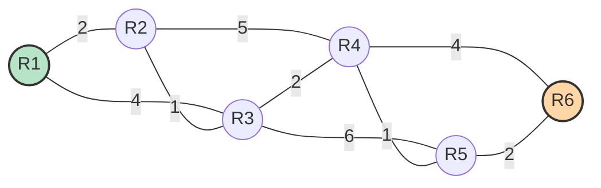

# RouteGuard — Link-State Routing & SPF Analyzer

RouteGuard is an interactive network analysis tool for link-state routing. It models a small ISP-style topology, runs deterministic Dijkstra SPF, and reports what happens to a source→destination pair when individual links fail.

**This is a simulator, not a protocol implementation.** It does not run IS-IS, OSPF, or any real control plane. It is a teaching and analysis tool for understanding SPF, failure impact, ECMP, and LFA coverage.

**Live demo:** [routeguard-taneesh.streamlit.app](https://routeguard-taneesh.streamlit.app)

## Features

- **Deterministic SPF** — Dijkstra with a lexicographic tie-break so results are stable across reruns.
- **Failure Impact Analyzer** — fail every link one at a time and classify the result as disconnected, rerouted, or no change.
- **Per-link repair** — remove one primary-path link and compute the shortest path in what remains (what a router does after a single failure).
- **Link-disjoint backup** — find a backup that shares **zero** links with the primary path, or report that none exists.
- **ECMP detection** — enumerate all equal-cost shortest paths and flag links common to all of them.
- **LFA / FRR coverage** — per-router local repair check: does the upstream router have an alternate neighbor that reaches the destination without transiting back through it?
- **IS-IS-style SPF trace** — Dijkstra step by step in IGP vocabulary (tentative distance, candidate list, predecessor, finalization).
- **JSON export** — download a full analysis snapshot for reproducibility.

## Quick Start

```bash
git clone https://github.com/TaneeshkaReddy/routegard.git
cd routegard
pip install -r requirements.txt
streamlit run app.py
```

The app opens at `http://localhost:8501`.

## Default Topology



Six routers, nine links. Edge labels are link costs. Green marks the source, orange the destination, for the default `R1 → R6` example.

## What the Tool Found on the Default Topology

For `R1 → R6`:

- Baseline shortest path: `R1 → R2 → R3 → R4 → R5 → R6` (cost 8)
- **No single link failure disconnects R1 from R6** — the topology is 1-link resilient for this pair.
- **5 of 9 link failures cause a reroute**; the other 4 leave the path unchanged.
- **No link-disjoint backup exists** for `R1 → R6`. Every alternate path shares at least one link with the primary. This is because R1's only useful egress is toward R2; removing that removes all diverse options.
- **Full LFA coverage (100%)** — every primary-path link has a local repair, meaning FRR can protect the entire path without waiting for IGP reconvergence.

These findings are exportable via the **Export** tab as a single JSON file.

## What This Project Deliberately Does Not Implement

Naming the gaps is part of the design:

- No real IS-IS or OSPF protocol engine (no PDUs, no LSDB, no adjacency state machine).
- No FRR data plane, no BFD, no MPLS/SR forwarding.
- No convergence timing, micro-loop analysis, or real control-plane dynamics.
- No node-protection LFA (only link protection).
- No TI-LFA or SR repair lists.
- No persistent storage; topology edits live in Streamlit session state only.

## Architecture

- `shortest_path_stable()` — deterministic Dijkstra; the foundation for everything else.
- `build_analysis_report()` — produces the JSON snapshot.
- `find_lfas()` — per-router LFA check.
- Streamlit UI organized into tabs: Route Details, Backup, Failure Impact, Disjoint Backup, ECMP, LFA Coverage, SPF Trace, Export.

## License

MIT

## Author

Taneeshka Reddy — [LinkedIn](www.linkedin.com/in/taneeshka-reddy-b720a8260)